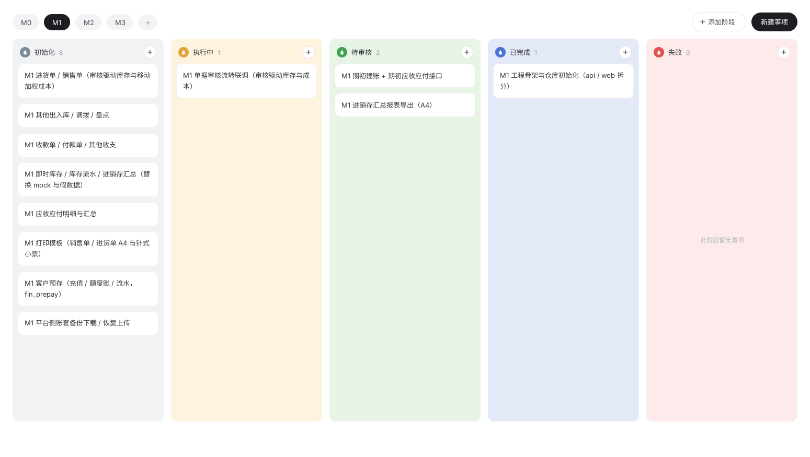

# dsh-taskboard

**English** | [简体中文](README.zh-CN.md)

A native "Taskboard" sidebar plugin for the DeepSeek Harness (DSH) Web GUI: one board per workspace, milestone tabs within a board, and task cards flowing across customizable stages (columns).



## Features

- **Milestone tabs**: M0 / M1 / M2… freely added and removed; right-click to rename / delete (the last milestone cannot be deleted, nor can one that still holds tasks).
- **Task cards**: right-click to edit (title + stage, one commit) or delete; drag by the grip handle to reorder within a stage or move across stages.
- **Customizable stages**: mix and match names with the 8-color palette — click a column-head dot to recolor, click a stage name to rename inline; adding a stage only needs a name (color picked at random); a stage that still holds tasks refuses deletion.
- **Default board**: a fresh workspace starts with one milestone "M1" and four preset stages (Init / Running / Review / Done).
- **Data is a file**: the whole board lives in `<workspace>/.dsh/taskboard/board.json` — no database; whole-board CAS (`expectedRevision`) guards concurrent writes, corrupt JSON is never overwritten. AI agents can reorder and edit the board directly with file tools.
- **Bilingual UI** (English / Chinese), following the host language setting.

## Concepts & data model

| UI concept | Meaning | `board.json` field |
| --- | --- | --- |
| Milestone | Tab M0 / M1 / M2… | `epics` |
| Task | A work-item card under a milestone | `tasks` |
| Stage | A named, colored flow step (column) | `columns` |

A task is one piece of work "in some milestone, sitting in some stage": `{ id, epicId, columnId, title, createdAt }`. Stage order = the order of `columns`; a task's display order within its stage = its relative order in `tasks` — there are no separate order fields, so editing the JSON directly is enough to reorder.

## Installation

The plugin is installed into a DSH profile as a local link (`cordis.patch.yml` injects the plugin row into the profile roster):

```sh
dsh plugin --profile <profile name> add link:<path to this repo>
```

After installing, **restart the DSH service**; a "Taskboard" card appears on the right sidebar's start page — click it to open the board for the current workspace.

## Development

```sh
pnpm install     # first-time dependency install
pnpm build       # tailwind → tsc declarations → tsdown (lib/index.js + lib/client.js + lib/types)
pnpm typecheck   # tsc --noEmit
pnpm test        # vitest run (7 specs / 92 tests under tests/)
```

Stack: TypeScript + React 18 + TailwindCSS (precompiled via `@tailwindcss/cli`, inlined into the bundle by tsdown) + tsdown + vitest. The host half is a cordis plugin registering the `/api/dsh-taskboard/*` routes (loopback fence); the browser half registers a right-sidebar tab via `ctx.sidebarRightTabs.register()`. After changing `src/client/**`, run `pnpm build` to regenerate `lib/client.js`.

### Directory structure

```
src/
  index.ts                Host entry: registers the /api/dsh-taskboard/* routes (mountOnce guard)
  core/board.ts           Data model + whole-board validation + removal guards + default board (shared by both halves)
  host/board-store.ts     board.json I/O: atomic write, whole-board CAS, corrupt-JSON protection
  host/workspaces.ts      Workspace enumeration and path normalization
  host/routes.ts          Three routes: workspaces / board (GET+PUT) / health
  client/
    index.ts              Client entry: registers the locale dictionaries + right-sidebar tab type
    right-panel.tsx       Tab type + guide card + tab body/title
    controller.ts         Framework-free board state and every operation (React reads via useSyncExternalStore)
    api.ts                Same-origin fetch client
    locales.ts            zh is the key source; en mirrors every key
    view/                 React board UI (panel / stage column / modals / drag-and-drop / icons)
design/                   Phase-0 design frames (4 HTML files + generator + screenshots + layout tools)
tests/                    7 specs / 92 tests: board, board-store, workspaces, routes, controller, right-panel, tint
```

## Design frames

`design/` holds the HTML sources of the four UI frames (main board / new-task modal / new-milestone modal / stage color popover), generated by `design/build-design-html.mjs` and converted into canvas design frames via ardot; `design/screenshots/` keeps the visual review shots of each version. The preview image at the top of this README is one of those renders.

## License

MIT
