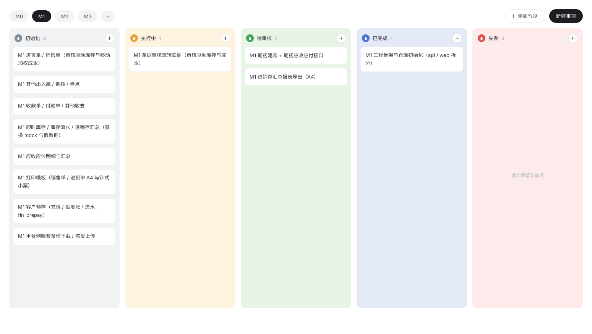

# dsh-taskboard

[English](README.md) | **简体中文**

为 DeepSeek Harness（DSH）Web GUI 开发的原生「任务看板」右侧栏插件：每个工作区一块看板，看板内用里程碑页签切分，事项卡片在可自定义的阶段（列）之间流转。



## 功能特性

- **里程碑页签**：M0 / M1 / M2… 自由增删；右键重命名 / 删除（最后一个里程碑不可删，仍有事项的里程碑不可删）。
- **事项卡片**：右键编辑（标题 + 所属阶段，一次提交）/ 删除；六点把手拖拽，同阶段内排序或跨阶段移动。
- **自定义阶段**：名称 + 颜色（8 色板）随意搭配——列头色块点选改色，阶段名点击 inline 改名；新增阶段填名即建（颜色随机）；阶段内仍有事项时禁止删除。
- **默认板**：新工作区自动初始化 1 个里程碑「M1」+ 4 个预置阶段（初始化 / 执行中 / 待审核 / 已完成）。
- **数据即文件**：整板存在 `<工作区>/.dsh/taskboard/board.json`，无数据库；整板 CAS（`expectedRevision`）写保护，坏 JSON 拒绝覆盖。AI agent 可直接用文件工具读改排序（数组顺序即展示顺序）。
- **中英双语** UI，跟随宿主语言设置。

## 概念与数据模型

| UI 概念 | 含义 | `board.json` 字段 |
| --- | --- | --- |
| 里程碑 | 页签 M0 / M1 / M2… | `epics` |
| 事项 | 里程碑下的工作条目卡片 | `tasks` |
| 阶段 | 带名字 + 颜色的流转环节（列） | `columns` |

事项即「某里程碑下、处于某阶段」的一条工作：`{ id, epicId, columnId, title, createdAt }`。阶段顺序 = `columns` 数组顺序；事项在其阶段内的展示顺序 = `tasks` 数组相对顺序——没有独立 order 字段，直接编辑 JSON 即可排序。

## 安装

插件以本地 link 方式装入 DSH 的 profile（`cordis.patch.yml` 负责把插件行注入 profile 名册）：

```sh
dsh plugin --profile <profile 名> add link:<本仓库路径>
```

装好后**重启 DSH 服务**，右侧栏「开始」页出现「任务看板」卡片，点击即可在当前工作区打开看板。

## 开发

```sh
pnpm install     # 首次安装依赖
pnpm build       # tailwind → tsc 声明 → tsdown（产出 lib/index.js + lib/client.js + lib/types）
pnpm typecheck   # tsc --noEmit
pnpm test        # vitest run（tests/ 下 7 个 spec，92 用例）
```

技术栈：TypeScript + React 18 + TailwindCSS（`@tailwindcss/cli` 预编译后由 tsdown 内联进 bundle）+ tsdown + vitest。宿主半区是 cordis 插件，注册 `/api/dsh-taskboard/*` 路由（loopback 围栏）；浏览器半区经 `ctx.sidebarRightTabs.register()` 挂右侧栏页签。改动 `src/client/**` 后需 `pnpm build` 重新生成 `lib/client.js`。

### 目录结构

```
src/
  index.ts                宿主入口：注册 /api/dsh-taskboard/* 路由（mountOnce 防重）
  core/board.ts           数据模型 + 整板校验 + 删除防护 + 默认板（宿主与浏览器半区共用）
  host/board-store.ts     board.json 读写：原子写、整板 CAS、坏 JSON 拒绝覆盖
  host/workspaces.ts      工作区枚举与路径规范化
  host/routes.ts          workspaces / board(GET+PUT) / health 三个路由
  client/
    index.ts              客户端入口：注册 locale 字典 + 右侧栏页签类型
    right-panel.tsx       页签类型 + guide 卡片 + 页签体/标题
    controller.ts         框架无关的看板状态与全部操作（React 经 useSyncExternalStore 读）
    api.ts                同源 fetch 客户端
    locales.ts            zh 为 key 源，en 完整对照
    view/                 React 看板 UI（面板 / 阶段列 / 弹窗 / 拖拽 / 图标）
design/                   Phase 0 设计稿（4 个 HTML + 生成器 + 截图 + 排布工具）
tests/                    7 个 spec / 92 用例：board、board-store、workspaces、routes、controller、right-panel、tint
```

## 设计稿

`design/` 内含 4 个界面帧的 HTML 源（主界面 / 新建事项弹层 / 新建里程碑弹层 / 阶段色板弹层），由 `design/build-design-html.mjs` 生成，经 ardot 转换为画布设计稿；`design/screenshots/` 存各版本视觉回看。README 顶部预览图即设计稿渲染。

## License

MIT
